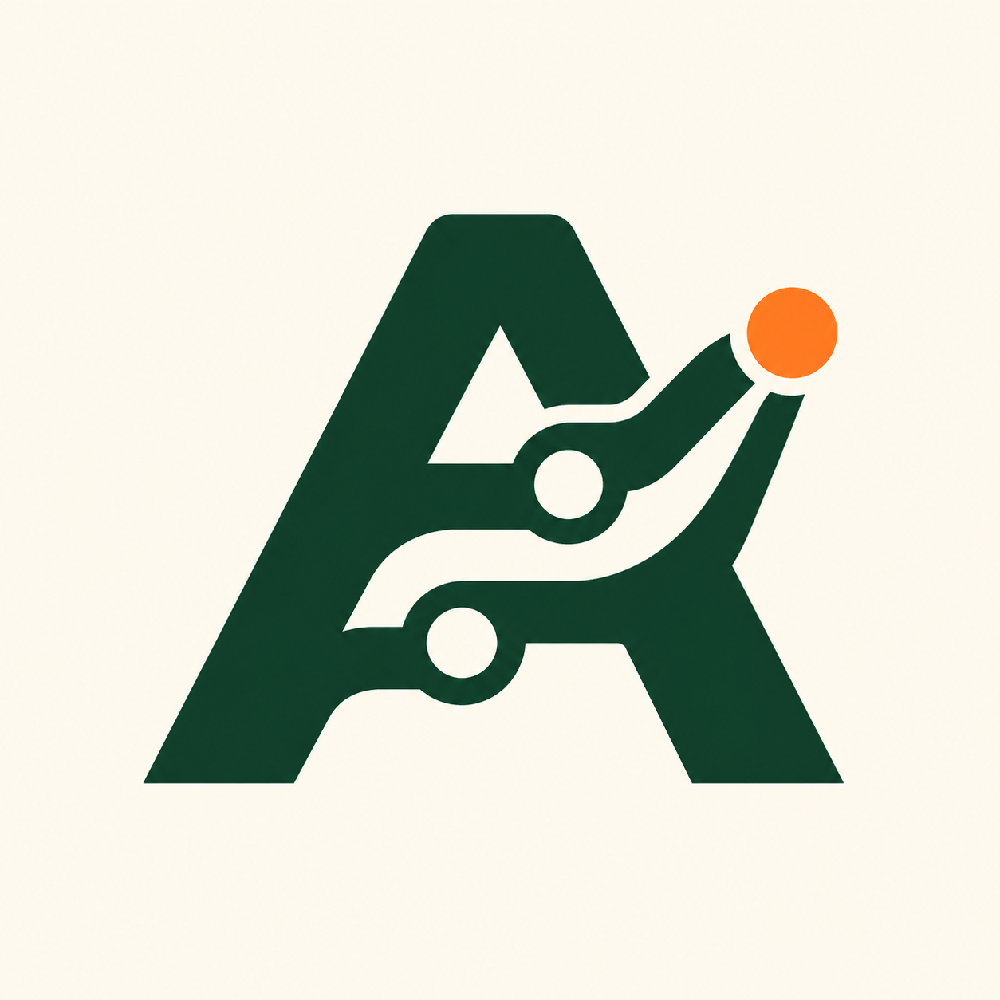

<p align="center">
  
</p>

# AgentFlow

A local dashboard for your coding agents. Keep tasks, agent activity, and review progress in one place.

AgentFlow runs on your machine with a Next.js interface and a SQLite database. No cloud account, hosted database, or Docker is required.

## What you can do

- Organize projects and tasks on a Kanban board.
- Browse local Codex chats and Claude Code sessions, including child agents.
- Track agent runs, workflow steps, dependencies, and review evidence through CLI or API reports.
- View saved GitHub PR metadata through an optional read-only connection.
- Export history and inspect reported token usage with optional local cost estimates.

AgentFlow observes work. Your existing tools start and run the agents. A successful implementation report moves a task to **Review**. Only a human can mark it **Completed** with acceptance evidence.

## Run locally

Use Node **24.15.0** and npm **11.12.1**. The verified host is macOS 27.0 on Apple Silicon. Linux and pristine-OS installation are not qualified.

From a checkout of this repository, run:

```sh
npm ci
npm run build
npm run local -- setup
npm start
```

Run `setup` in your interactive terminal. It displays two separate tokens. Open [the pairing page](http://127.0.0.1:3000/pair) and enter the **pairing token**. The reporter token is for CLI and API reports and cannot pair a browser.

Use `npm start` to launch the app. The launcher initializes private storage and listens only on `127.0.0.1`. For development, use `npm run dev`.

AgentFlow stores its data in `~/Library/Application Support/AgentFlow` by default. To use another location, set `AGENTFLOW_DATA_DIR` to an absolute local path outside the application checkout. The path must have no symlink components and must meet the ownership and permission requirements in the [setup reference](docs/REFERENCE.md#run-the-local-application).

Stop the service before maintenance. See the [recovery runbook](docs/RECOVERY.md) for backups, restore, and credential rotation.

## Connect your agents

For **Codex**, keep Codex installed on the same machine, pair your browser, and open **Codex** in the navigation. Local chats appear without reporter tokens or per-chat registration. Remote-host and cloud-only chats are not included.

For **Claude Code**, open **Claude sessions**. AgentFlow reads local session transcripts from `~/.claude` or your configured directory. Claude's transcript format is undocumented and may change.

Both connectors read history without starting or changing agent work. Only paired browsers can access that history. Connector content stays out of AgentFlow's business database and exports.

For other tools, use the [CLI and HTTP API](docs/API.md) to report runs and workflow progress. See the [connector reference](docs/REFERENCE.md#see-your-existing-codex-work) for configuration, access rules, and source limits.

## Develop and verify

Run the routine checks:

```sh
npm run test:unit
npm run lint
npm run typecheck
npm run build
```

Browser tests use Playwright. The full integration suite also needs qualified historical builds and private evidence directories. Follow the [contributor verification reference](docs/REFERENCE.md#historical-integration-prerequisites) before running those suites. An ordinary checkout is not enough for full release qualification.

## Read more

- [Product context](PRODUCT.md) explains the purpose and constraints.
- [Architecture](docs/ARCHITECTURE.md) describes the system and its boundaries.
- [API reference](docs/API.md) covers reporting and integration contracts.
- [Detailed reference](docs/REFERENCE.md) covers setup, connectors, GitHub credentials, and contributor verification.
- [Roadmap](ROADMAP.md) and [implementation plan](PLAN.md) track delivery.
- [Delivery ledger](docs/DELIVERY.md) and [release evidence](docs/implementation/W04.md) record verification and its limits.

[v1.0.0 source release](https://github.com/AlesSystems/agentflow/releases/tag/v1.0.0). AgentFlow-owned material, including the logo, is licensed under [MIT](LICENSE). Copyright 2026 AlesSystems.
