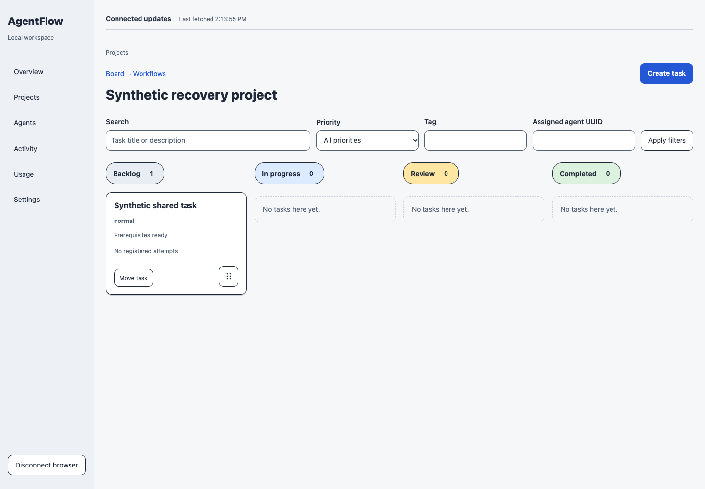
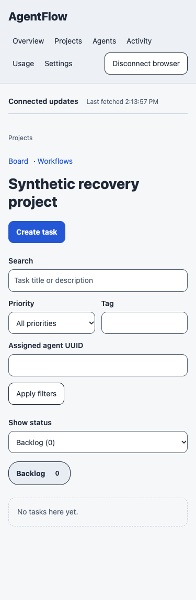
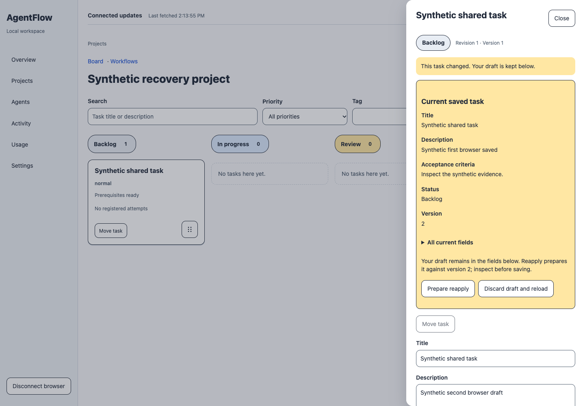
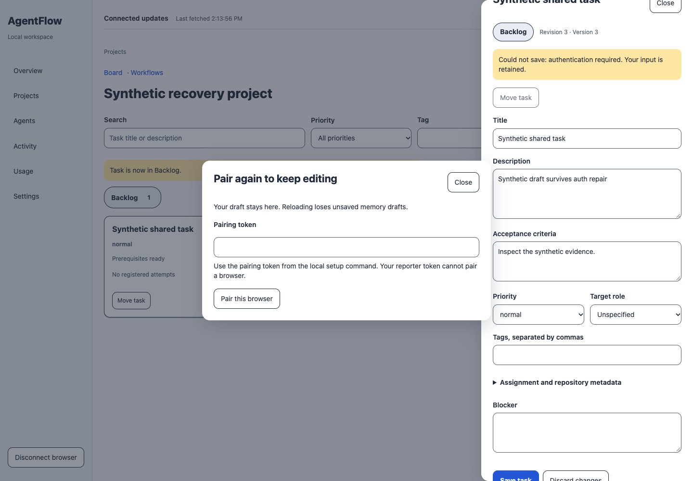
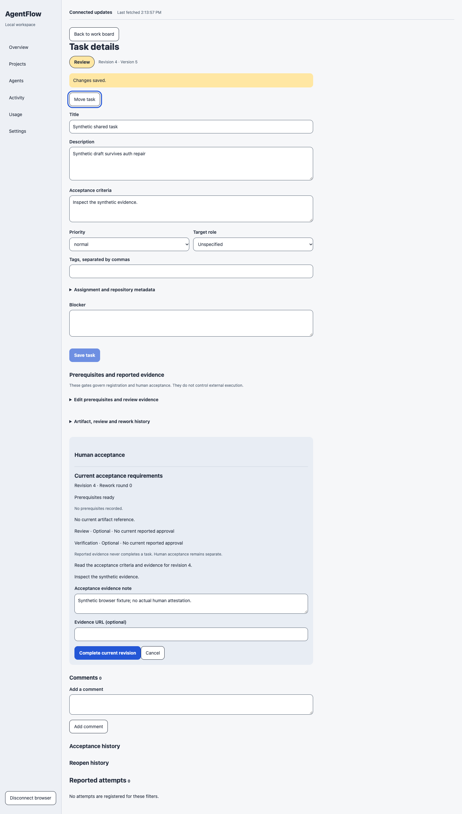
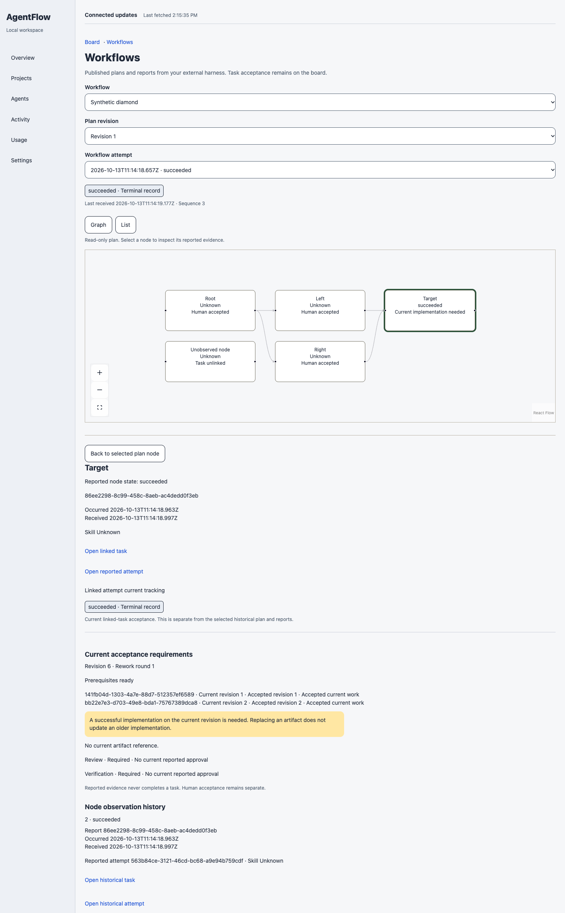
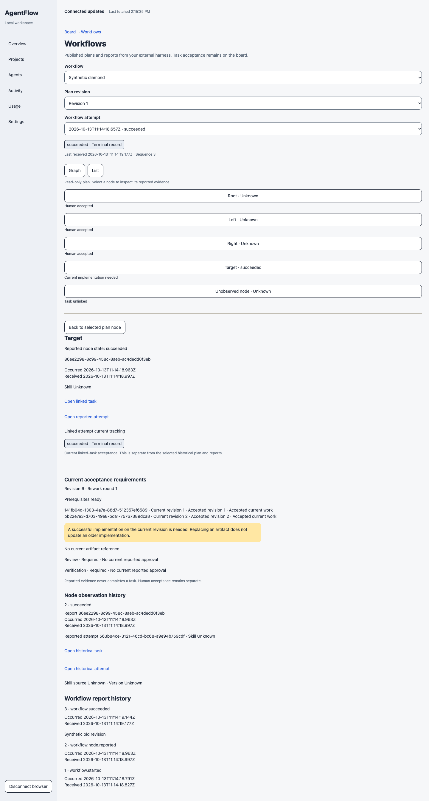
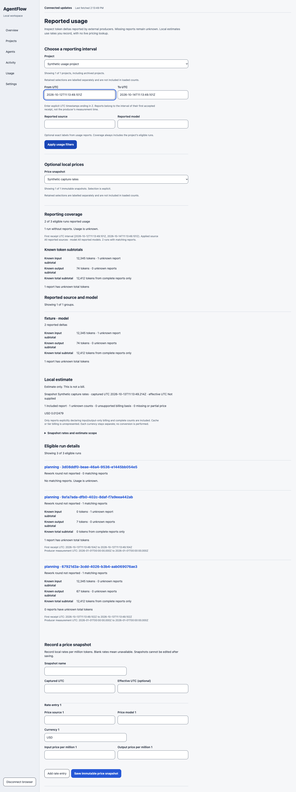
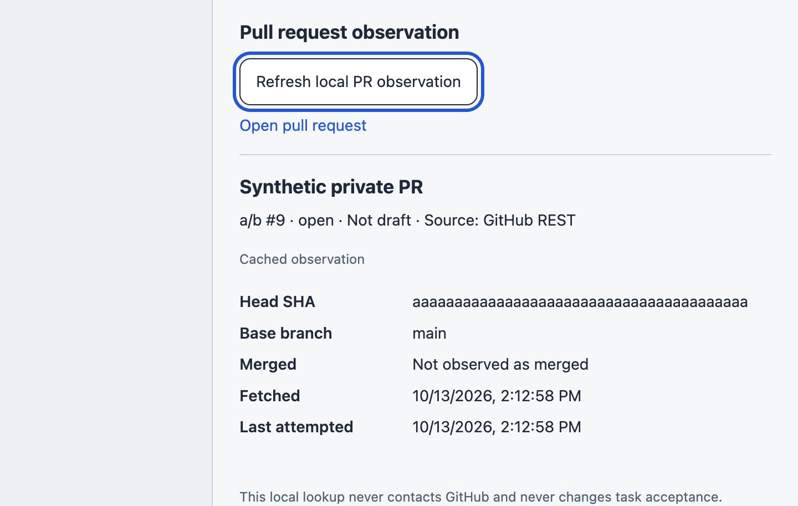
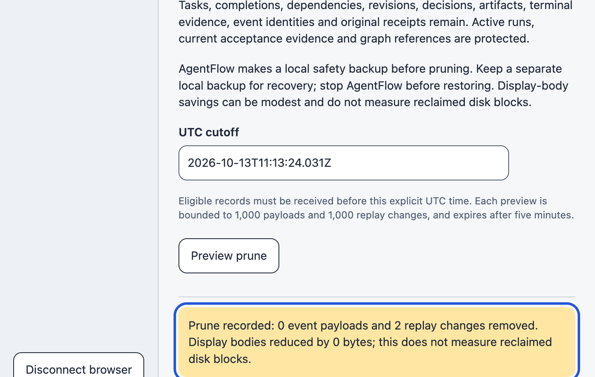

# W04 public synthetic evidence

This candidate publishes scalar summaries and exactly 10 UI04-approved original PNGs from source `741b58f`, qualified build `hSgNCwK5uvX3pzMJW3iYo`, Chrome 155. The raw campaign remains false/exit 1; Root accepted Task 4 only with the separate exact 14-group Astra disposition. Whole-candidate review, integration and release remain open.

See [the receipt](../../implementation/W04.md), [scalar evidence](acceptance.json), and [image hashes/captions](media.json). Raw headers, tokens, databases, process/environment records, full original request distributions, all videos and private-path captures remain private. PNGs establish appearance; successful source-bound predicates establish behavior. Synthetic acceptance is not human attestation.

## N41: Synthetic Work board with desktop lanes.

## N42: Synthetic Work board at 375px with one selected lane and stacked filters.

## N40: Saved task state and retained second-browser draft shown separately after conflict.

## N38: In-app pairing repair preserves a synthetic task draft; token field is empty.

## N39: Explicit current-revision acceptance requirements and a synthetic note; this is not human attestation.

## N04: First independently paired synthetic workflow tab, graph view. Appearance alone does not prove navigation.

## N05: Second independently paired synthetic workflow tab, equivalent list view.

## N01: Synthetic usage coverage and named local estimate; unreported counts remain unknown and estimates are not bills.

## N24: Synthetic cached PR observation at native 200% Chrome zoom, with visible refresh focus.

## N27: History controls and focused successful prune feedback at native 200% zoom; display-body savings are distinct from disk reclamation.

