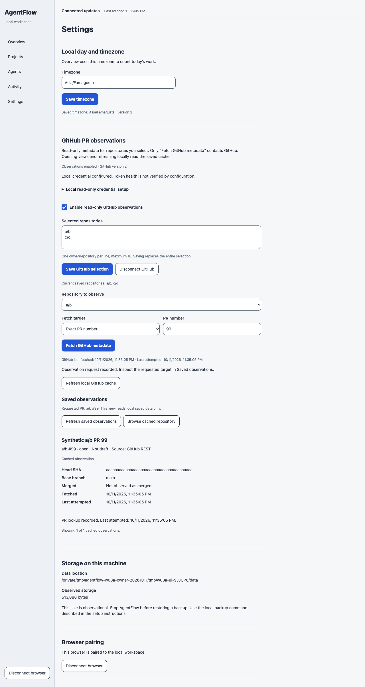
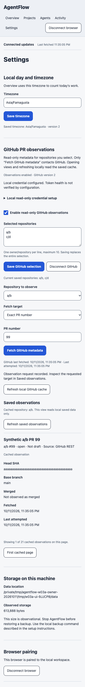
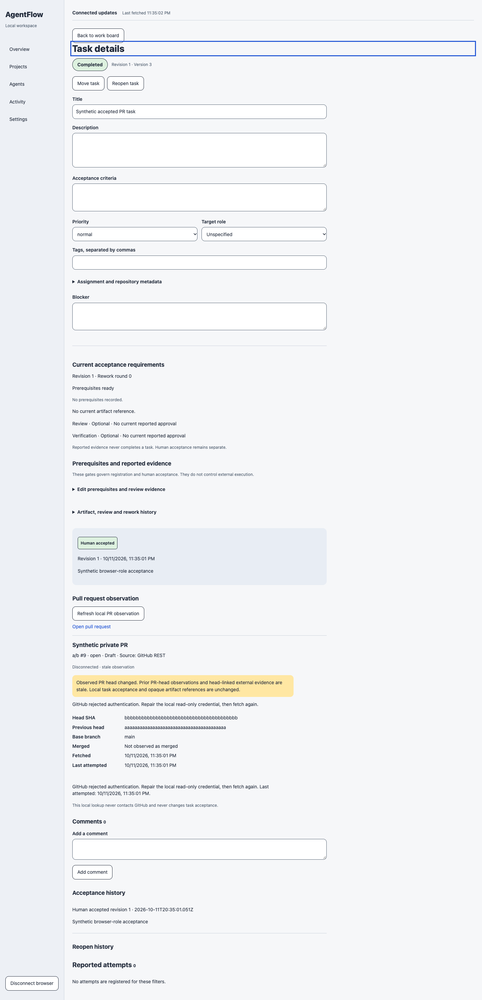
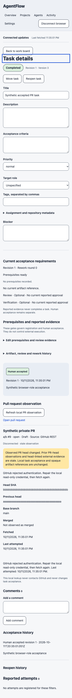

# W03a implementation and qualified verification

Operators can explicitly observe PR metadata from up to ten selected GitHub
repositories. The connection starts disabled, the remote adapter uses GET only,
and private cached lookups require a paired browser session. Refresh does not
change task DTOs, work revisions, opaque artifacts or human-only acceptance.

Root accepted qualified verification at executable
`3484cb4a20cd0070efdb1aa5c195043a9559d025`, after independent data/source audits and
an Astra medium exception for one measured settings regression. The original
quiet run still has **exit 1 and `valid:false`**. Final package Standards/Spec
review, PR integration, evidence archival and guarded cleanup remain open.
W03a is unmerged; W03b–W04 and complete-v1 release remain separate gates.

The [public allowlisted summary](../evidence/W03a/acceptance.json) contains the
counts, comparisons, qualifications and image hashes. Raw databases, credentials,
cookies, process identities, logs, samples and private reports are retained
privately. Their published SHA256 pins are integrity references, not public links.

## Contract and implemented behavior

This implements [the roadmap's Phase 3 scope](../../ROADMAP.md#phase-3-workflow-tracking-and-supporting-tools),
[the W03a workflow contract](../V1_WORKFLOWS.md#w03a-optional-read-only-github-pr-metadata)
and [the implementation checklist](../superpowers/plans/2026-10-11-w03a-github.md).
It preserves [ADR-002](../DECISIONS.md#adr-002-observe-the-existing-harness),
[ADR-004](../DECISIONS.md#adr-004-separate-execution-from-human-acceptance) and
[ADR-007](../DECISIONS.md#adr-007-treat-localhost-as-a-network-boundary).
The historically approved plan input has SHA256
`d09e19625ef1251f75082728a8e8eba8eb45e82c667f4bd5e54e64331a8cded5`.
Checklist status updates do not change that historical approval or its scope.

Migration 0008 preserves migrations 0000–0007. A separate connection version,
projected cache and durable refresh intent/result ledger use the existing Store
transaction, receipt and change owners. No network operation holds a SQLite
transaction. Admission binds principal, method, path, key, digest, generation and
selected configuration. Exact retries share active work or return the original
completed receipt; conflicting bodies reject before credential/network access.
Different busy requests consume no key. Publication rechecks generation, version
and selection, so changed configuration supersedes the old observation.

Each browser refresh selects one repository and one 20-row list page, bounded
1–1000, or a positive safe-integer PR number. Production fixes the GitHub origin,
rejects redirects and uses API version `2026-03-10`, verified against official
GitHub documentation on 2026-10-11. Headers and body share an eight-second deadline;
responses are bounded at 2 MiB. Only number, canonical URL, title, state, draft,
head SHA, base branch, merged time and local observation/error times are projected.
Body, diff, comments, profiles and arbitrary upstream error text are discarded.
[Official API-version documentation](https://docs.github.com/en/rest/about-the-rest-api/api-versions?apiVersion=2026-03-10)
and [PR permission/endpoint documentation](https://docs.github.com/en/rest/pulls/pulls?apiVersion=2026-03-10)
were the adapter's dated inputs.

Rate gates persist safe retry times without automatic sleep, retry or polling.
Repository saves, disconnect/re-enable and scope replacement preserve the active
connection-wide deadline. A focused final Spec repair verifies this behavior;
its new candidate remains pending independent review and Root acceptance.
GET, navigation, focus, local paging and workspace invalidation read only the
cache. Settings exposes the requested repository/exact PR and bounded cached
pages. Task details provide a canonical selected PR link only after explicit
activation. The private lookup does not expose PR titles to reporter task DTOs
or SSE; invalidations contain only fixed connection identity.

Failure, disconnect, an absent list item and inaccessible metadata retain prior
observations with honest stale/error labels. A 404 does not prove deletion.
A changed head retains the previous differing SHA and marks prior head-linked
external observations stale. It does not guess that an opaque W02 artifact is a
SHA or change local review applicability/acceptance. Shutdown aborts and drains
refreshes before Store closure. Startup resolves interrupted intents without a
remote retry. Restart, backup/restore and renewed generation preserve retained
cache facts.

## Operator credential setup

Use an existing fine-grained GitHub token restricted to the selected repositories
with Pull requests read permission. In a local file editor, save a strict JSON
object with only its `token` property. Keep the file outside the active checkout,
owned by the launching account, regular, mode `0600`, single-linked and without
symlink components. Configure the absolute `AGENTFLOW_GITHUB_TOKEN_FILE` path in
the local launch environment and restart AgentFlow. Do not enter token values
into browser inputs, URLs, shell commands or shell history.

The opened descriptor is checked before bounded UTF-8/strict JSON parsing, with a
4096-byte limit and an opaque non-whitespace token. Only an admitted explicit
refresh reads it. UI metadata reports configured, unavailable or repair state,
never its path/value. Configured is not verified GitHub token health. Production
has no remote-origin override. [README setup](../../README.md#optional-read-only-github-observations)
and [API contracts](../API.md#w03a-local-github-observations) describe use.

## Executed checks and source qualifications

| Check | Actual result | Qualification |
| --- | --- | --- |
| Full unit | 201 passed / 39 files, exit 0 | Clean `60827b8` |
| Original full integration | 493 passed, 3 failed / 496 tests / 93 files, exit 1 | Clean `60827b8`; two migration-list literals and schema 8 expectation |
| Affected validator repair | 19 passed / 2 files, exit 0 | Three failures closed by truthful migration 0008/schema 9 assertions; historical source pins unchanged |
| New qualification controls | 10 passed / 1 file, exit 0 | Later helper/fixture contracts; synthetic `acceptance:false` controls |
| Integration composition | 506 unique contracts | 496 original cases plus 10 new controls; not a fresh whole all-pass run |
| Focused fixture consumers | 8 passed / 3 files, exit 0 | Repeats already counted runtime/bounds/GitHub HTTP cases |
| Full Chrome | 72 passed, no skips, exit 0 | `60827b8`; current application bytes unchanged |
| Types, lint, production build/native load | exit 0 | Own locked current installation/build; later helper types/affected lint also exit 0 |
| Original npm OpenAPI | exit 1 before registry execution | `tsx` CLI IPC setup failed on the long temporary socket path |
| Direct OpenAPI reroute | exit 0 | `node --import tsx scripts/openapi.ts --check`; registry/examples/output match |

Actual current production build source is `60827b8`. All 108 production inputs
and 442 compiled files remained unchanged through measured `3484cb4`. The
baseline is clean `1ce0c52`, with its own locked install, native addon and 439-file
build. Neither source borrows historical dependencies or compiled output. The
P07 and W01 source-specific upgrade prerequisites also have separate qualified
installs/builds. Build IDs, source/runtime/driver pins and original exits remain
in retained manifests and the allowlisted summary.

Before helper fixes, the first control attempt failed at cwd/test discovery;
corrected stream RED had two meaningful failures. The remaining contract RED had
six failures and two passes. Final ten GREEN controls exercise actual separate
child streams, failed startup, forced/nonzero shutdown, rejected pairing, HTTP
failure with cleanup failure, complete denominator reconciliation, strict 250 ms
boundaries and schema-valid wrong seed/provenance fields. The additive fixture
capture callback is two lines; production lifecycle code is unchanged.

Earlier invocations retain their actual HEAD/dirty state and before/after source
brackets. Passing helper/module/control bytes were later matched to committed
Git blobs; documentation does not retrospectively claim clean final-HEAD runs.
Final preflight ran clean `3484cb4`. Synthetic browser-role acceptance is not a
human attestation.

The tested host is macOS 27.0 build 26A428, arm64 Apple M4 Pro, 24 GB memory,
12 cores, Node 24.15.0, npm 11.12.1 and Chrome 154.0.8037.99. This qualifies a fresh
locked checkout on the existing named host, not a pristine OS or Linux. Original
npm notices report nine audit vulnerabilities, four moderate and five high.
Dependency deprecations and the existing filesystem
tracing build warning are retained. No automatic audit repair was performed.

## One finite quiet run and scoped exception

The one released run lasted 6.038758583 seconds at `3484cb4`. It captured all
990 unique requests, 90 warmups and 900 measured samples, across three interleaved
baseline/head settings pairs and three new cached-read groups. Each group has
10 warmups and 100 measured samples. Round 2 reverses settings order. Independent
review reconciled all 1005 original files, response bodies, complete controller
dispatch-to-drain clocks and exact nearest-rank p95 reductions. No missing,
failed, unconfirmed, duplicate or invalid request was filtered or manufactured.

| Repetition | Settings baseline p95 ms | Settings head p95 ms | Relative increase | Cached PR read p95 ms |
| --- | ---: | ---: | ---: | ---: |
| 1 | 0.813875 | 0.851417 | +4.612748% | 1.162042 |
| 2 | 0.828208 | 0.929584 | +12.240403% | 1.103125 |
| 3 | 0.836584 | 1.045000 | +24.912740% | 1.087917 |

Every settings baseline/head and cache group is strictly below 250 ms. The sole
failure is `settings-regression-3`; its absolute p95 delta is 0.208416 ms.
Astra medium approved that exact exception on 2026-10-12, and Root accepted the
qualified verification after an independent data/source audit. The original
**exit 1 / `valid:false`** remains immutable. All three settings comparisons
increase; the cause is unknown. No causal profiling, noise conclusion, resample,
averaging-away or general budget waiver is claimed. The exception does not apply
to another source/workload or W04.

The head fixture contains 1000 projected PR rows across ten repositories, seeded
through 50 Store-admitted/finalized synthetic 20-row outcomes. It has 50 final
intents, 51 receipts, 51 changes and no old core tasks. This is fixture preparation,
not live or remote-fetch evidence. All six before/after cache/attempt/receipt/change
snapshots match. Pairing legitimately changes sessions: four baseline and seven
head sessions match preflight plus the nine paired measurement services. All nine
services closed gracefully with exit 0/null signal and separate original stdout/
stderr retained; outbound calls were zero. All 550 source and 442 compiled files remained
stable. This finite local-read result supplies no W04 throughput, concurrent
browser latency, cold-start, arbitrary-history or remote GitHub claim.

## Synthetic appearance evidence

These four original captures were copied without editing or recapture. They show
repaired affordances and appearance, not timing, persistence or live GitHub proof.
Settings contains a non-sensitive synthetic temporary data location, not a
credential path. Browser-role acceptance in these fixtures is not human attestation.

## Retained limitations and next gate

Authorized live GitHub verification is unexecuted. Delivery credentials were not
repurposed; deterministic adapter/credential fixtures are the implemented proof.
The original backend raw compiled output was overwritten during later UI work;
its historical source/manifest/log qualification remains, without reconstruction.
Original UI03's 461 compiled files survive in an exact private archive. The current
fresh build has 442 files; the earlier 469 figure belongs to the UI repair ancestor.
Early global npm cache effects have no before-census. No untouched-global-cache
or complete rollback claim is made.

Root next audits public evidence and the exact final candidate, obtains independent
Standards/Spec review, creates/attaches the scoped PR, normally merges against its
matching head and archives necessary private evidence before guarded cleanup.
PLAN package boxes remain open until reviewed integration. No W03b start or v1
completion is claimed here.
